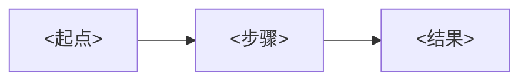

# 项目概述

> **填写指南**：本文件回答「这是什么项目、为什么做、给谁用、不做什么、怎么衡量成功」。所有后续文档（PRD、SRS、SAD 等）都以本文件为上游输入；本文件变化时需同步检查下游。

## 1. 项目背景

> **填写指南**：说明问题起源与现状。常见结构：现状痛点 → 现有方案不足 → 本项目的切入点。避免用营销语言；用事实、数据或可观察现象支撑。

## 2. 产品定位

> **填写指南**：一句话定位（面向谁、解决什么问题、以什么形式），下方补充边界声明（本系统不是什么）。定位语与 `CONTEXT.md` §1 一致。

> `<一句话定位>`

本系统不是 `<列出 2-3 个常见误解的边界>`。

## 3. 项目目标

### 3.1 用户价值目标

> **填写指南**：从用户视角描述价值，可量化优先。例如「用户 1 分钟内完成关键决策」「错误率低于 X%」。

### 3.2 技术目标

> **填写指南**：从工程视角描述目标，和 SAD 的架构目标形成呼应。例如「核心路径不依赖单一外部服务」「本地可独立运行」。

## 4. 项目范围

### 4.1 MVP 范围

> **填写指南**：列出 MVP 必须具备的能力。每条用动宾结构，避免模糊。

### 4.2 第二阶段

> **填写指南**：MVP 验证后的下一步能力清单，有依赖关系的用「依赖 MVP 中的 X」注明。

### 4.3 后续范围

> **填写指南**：远期可能的方向，仅记录不承诺。

### 4.4 明确不包含

> **填写指南**：显式写出不做什么，防止范围蔓延。常见项：替代官方/法定能力、违反合规的功能、远超目标用户的高级能力。

## 5. 目标用户与场景

> **填写指南**：用表格描述主要用户角色、核心场景、主要诉求。与 `CONTEXT.md` §3 对齐。

| 用户角色 | 核心场景 | 主要诉求 |
| --- | --- | --- |
| `<角色>` | `<场景>` | `<诉求>` |

## 6. 核心业务流程

> **填写指南**：画出核心价值流（从用户触发到结果呈现）。使用 Mermaid 流程图或时序图，节点数量控制在 5-10 个，命名使用 `CONTEXT.md` §2 的术语。

## 7. 关键假设与约束

> **填写指南**：列出项目成立所依赖的假设（如「用户有稳定网络」）和不可逾越的约束（如「必须符合 X 合规」）。假设被证伪或约束变化时，需触发范围评审。

## 8. 风险与应对

> **填写指南**：列出可能影响项目成败的风险（技术、商业、合规、团队），每项标注概率/影响/应对策略。高风险项应有缓解措施并追踪。

| 风险 | 概率 | 影响 | 应对 |
| --- | --- | --- | --- |
| `<风险>` | `<高/中/低>` | `<高/中/低>` | `<策略>` |

## 9. 成功指标

> **填写指南**：MVP 和二期各自的北极星指标 + 支撑指标。指标必须可测量、有基线、有目标值和检视周期。

- **北极星指标**：`<指标> = <目标值>（基线 <值>，检视周期 <周/月>）`
- **支撑指标**：
  - `<指标 1>`
  - `<指标 2>`

## 10. 相关参考资料

> **填写指南**：列出竞品、行业标准、关键文献、法规文档。标注版本/日期；可能变化的来源要有访问时间。

## 11. 变更记录

| 版本 | 日期 | 变更说明 |
| --- | --- | --- |
| `<0.1.0>` | `<YYYY-MM-DD>` | `<初始化>` |
