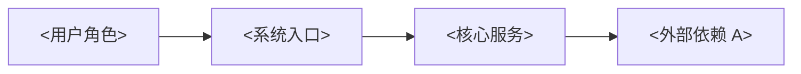
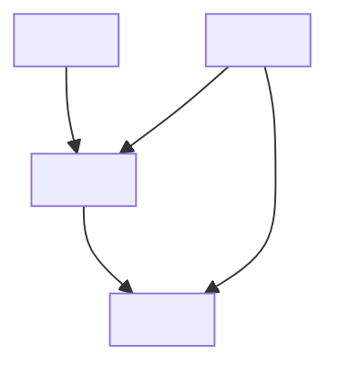
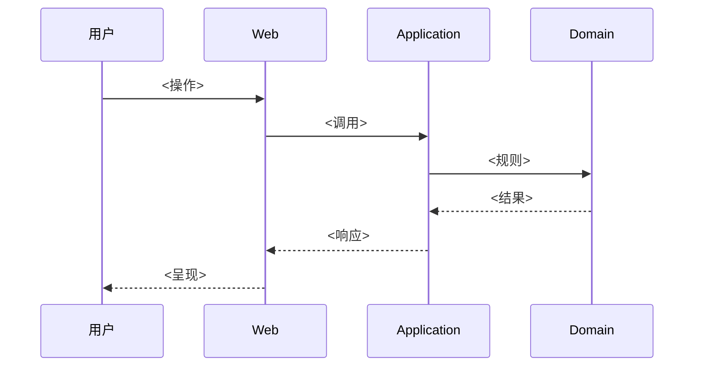

# 系统架构设计（SAD）

> **填写指南**：SAD 回答「系统怎么拆、技术怎么选、关键流程怎么走」。**§2 技术选型是整个项目技术栈的单一事实来源（SSOT）**；其他文档（开发规范、数据库、API、部署）引用本节，禁止重复定义或散落修改。

## 1. 架构目标

> **填写指南**：3-6 条，和 `00-项目概述` 的技术目标呼应。每条可以验证（如「核心路径不依赖单一外部服务 → 能证明单服务 down 时核心流程仍可降级运行」）。

- `<目标 1>`
- `<目标 2>`

## 2. 技术选型（SSOT）

> **填写指南**：**本节是整个项目技术栈的单一事实来源**。任何其他文档引用技术栈时，用「详见 SAD §2.X」而非复制。本节由 `INIT-GUIDE.md` 第 ① 步「技术栈」问题的答案直接落位。重大技术栈变更必须产出 ADR 并更新本节。

### 2.1 技术基线一览

| 层级 | 技术 | 版本 | 选型理由 | 关联 ADR |
| --- | --- | --- | --- | --- |
| 后端语言与框架 | `<例：.NET 10 + ASP.NET Core>` | `<版本>` | `<原因>` | `<ADR-NNNN>` |
| 前端语言与框架 | `<例：Blazor Web App>` | `<版本>` | `<原因>` | `<ADR-NNNN>` |
| 关系数据库 | `<例：PostgreSQL>` | `<版本>` | `<原因>` | `<ADR-NNNN>` |
| 缓存 | `<例：Redis 7（可选）>` | `<版本>` | `<原因>` | `<ADR-NNNN>` |
| 容器化 | `<例：Docker Engine 26+>` | `<版本>` | `<原因>` | `<ADR-NNNN>` |
| AI/LLM | `<例：OpenAI 兼容协议>` | `<版本>` | `<原因>` | `<ADR-NNNN>` |
| 日志/监控 | `<例：Serilog + OpenTelemetry>` | `<版本>` | `<原因>` | `<ADR-NNNN>` |
| 测试 | `<例：xUnit + Playwright>` | `<版本>` | `<原因>` | `<ADR-NNNN>` |

### 2.2 技术选型原则

> **填写指南**：列出做选型决策时遵循的原则（如「优先成熟稳定」「可降级运行」「单机起步」「长期可横向扩展」）。原则间冲突时记录优先顺序。

### 2.3 未选中的候选

> **填写指南**：列出被评估但未选中的技术，以及放弃原因。防止下次重新讨论时信息丢失。

| 候选 | 用途 | 未选理由 |
| --- | --- | --- |

## 3. 架构原则

> **填写指南**：3-6 条跨层的工程原则，例如「依赖倒置」「标准模型」「保守降级」「规则优先」「先模块化单体」。原则在后续分层职责与质量属性策略中逐一落地。

## 4. 系统上下文

> **填写指南**：画出系统与外部参与者（用户、第三方服务、运维）的边界。用 Mermaid 的 flowchart 或 C4 Context 图。



## 5. 逻辑架构

> **填写指南**：画出内部分层与模块。层间依赖方向明确标注，禁止反向依赖。



### 5.1 解决方案结构

> **填写指南**：按选定的技术栈给出项目目录骨架。.NET 用 `src/`、`tests/`；Node 用 `apps/`、`packages/`；小程序用自己的目录约定。

```text
<目录结构骨架>
```

## 6. 模块职责

> **填写指南**：对每个模块说明职责和不允许依赖的内容，防止职责边界腐化。

| 模块 | 职责 | 不允许依赖 |
| --- | --- | --- |
| `<模块>` | `<职责>` | `<不允许依赖的内容>` |

## 7. 关键流程

> **填写指南**：挑选 2-5 条跨模块的核心流程，用时序图或流程图呈现。每条流程覆盖正常路径、关键降级分支和错误处理入口。

### 7.1 `<流程名>`



## 8. 数据流与一致性

> **填写指南**：数据从采集/输入 → 处理 → 存储 → 展示的全链路；强一致、最终一致、可容忍过期的分段标注。

## 9. 质量属性策略

> **填写指南**：对每个 §5 NFR 提供架构级落地策略（限流、幂等、缓存、异步、熔断、降级等），不涉及具体实现细节。

| 质量属性 | 架构策略 | 关联 NFR |
| --- | --- | --- |
| 性能 | `<策略>` | `NFR-P-001` |

## 10. 可观测性

> **填写指南**：架构层面约定日志/指标/追踪的采集点、聚合位置、保留策略。详细规范在 `09-日志设计.md`。

## 11. 安全架构

> **填写指南**：认证、授权、密钥管理、数据分级与加密的架构落地。详细规范在 `08-权限设计.md`。

## 12. 可演化性

> **填写指南**：列出已识别的扩展点（Provider 接口、Feature Flag、模块边界）与未来可能的架构演进路径（如模块化单体 → 微服务）。

## 13. 变更记录

| 版本 | 日期 | 变更说明 |
| --- | --- | --- |
| `<0.1.0>` | `<YYYY-MM-DD>` | `<初始化>` |
