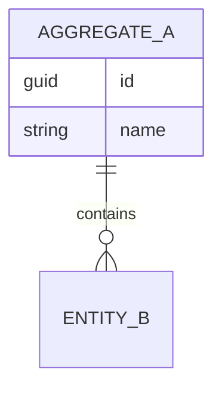

# 数据库设计

> **填写指南**：本文件回答「数据怎么存、怎么查、怎么迁移、怎么备份」。表结构、索引、约束、迁移脚本的最终事实来源在代码里；本文件保留设计意图与权衡。

## 1. 数据库选型

> **填写指南**：具体选型详见 [`03-系统架构设计(SAD).md`](<./03-系统架构设计(SAD).md>) §2 技术选型。本节只记录为什么选、与哪些 ADR 关联。

## 2. 数据模型概览

> **填写指南**：以 ER 图（Mermaid `erDiagram`）或领域对象图展示主要实体及其关系。细节在后续小节。

## 3. Schema 分层策略

> **填写指南**：是否使用 schema 隔离（公共、业务域、审计、临时）；多租户 / 多环境的隔离策略。

## 4. 表结构

> **填写指南**：每张核心表给出名称、用途、关键字段、约束。字段单位和缺失语义必须显式。索引单列、复合索引、唯一约束在 §5 统一列出。

### 4.1 `<table_name>`

- **用途**：`<一句话>`
- **主键**：`<字段>`
- **关键字段**：

| 字段 | 类型 | 可空 | 默认值 | 含义 | 单位 |
| --- | --- | --- | --- | --- | --- |
| `<col>` | `<type>` | `<Y/N>` | `<default>` | `<含义>` | `<单位>` |

- **约束**：`<外键、唯一、CHECK>`

## 5. 索引策略

> **填写指南**：每个索引说明服务于哪些查询场景，覆盖字段顺序，是否部分索引。慎重添加索引，权衡写放大。

| 索引 | 字段 | 类型 | 服务场景 | 预估写放大 |
| --- | --- | --- | --- | --- |

## 6. 迁移策略

> **填写指南**：迁移工具（EF Core Migration / Flyway / Prisma Migrate 等）、迁移命名约定、禁用的危险操作（如直接 DROP COLUMN）、生产执行流程。

## 7. 数据保留与清理

> **填写指南**：每类数据的保留周期、过期清理策略、合规要求（GDPR / 个人数据）。涉及软删除的字段标注。

| 数据域 | 保留周期 | 清理方式 | 合规要求 |
| --- | --- | --- | --- |

## 8. 备份与恢复

> **填写指南**：备份频率、保留份数、备份位置、恢复演练周期。生产 Runbook 中有具体命令，本节保留策略层面。

- **全量备份**：`<频率、保留>`
- **增量 / WAL**：`<策略>`
- **恢复 RTO/RPO**：`<目标值>`
- **演练周期**：`<周/月>`

## 9. 性能基线

> **填写指南**：常见查询的目标响应时间、慢查询阈值、容量规划（预期行数、增长率）。超出基线触发优化任务。

## 10. 变更记录

| 版本 | 日期 | 变更说明 |
| --- | --- | --- |
| `<0.1.0>` | `<YYYY-MM-DD>` | `<初始化>` |
