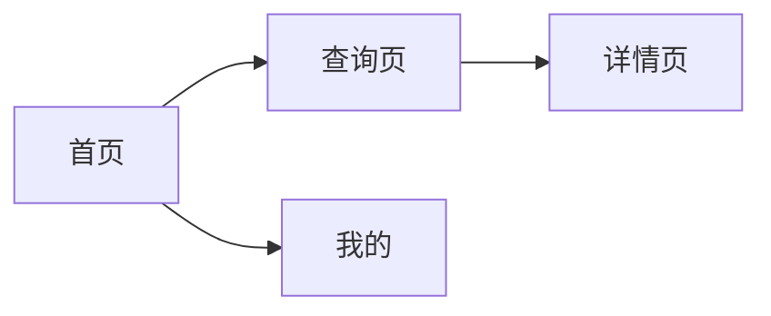
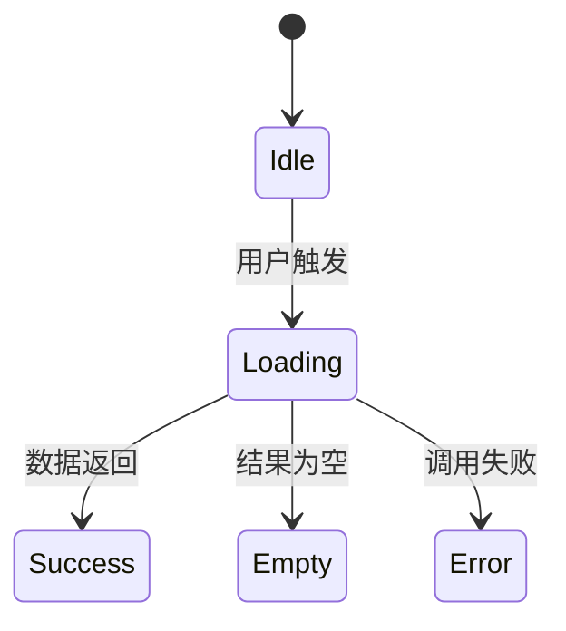

# 前端 UI 设计

> **填写指南**：本文件回答「页面怎么组织、状态怎么流转、多端怎么适配」。技术栈无关，适用于 Web / 移动端 / 小程序。具体组件实现见 `12-前端组件设计.md`。

## 1. 信息架构

> **填写指南**：画出一级/二级导航、页面层级、页面之间的跳转关系。导航深度建议不超过 3 层。

## 2. 页面清单

> **填写指南**：按路由列出所有页面，说明用途、入口来源、权限要求、关键 FR。

| 路径 | 用途 | 入口 | 权限 | 关联 FR |
| --- | --- | --- | --- | --- |

## 3. 页面状态机

> **填写指南**：对关键页面画出状态流转（空闲 / 加载 / 成功 / 空数据 / 失败 / 降级）。每个状态都要有对应 UI；避免只实现成功路径。

### 3.1 `<页面名>`

## 4. 响应式与多端适配

> **填写指南**：定义断点（桌面 / 平板 / 移动）和布局策略；小程序平台的独立适配（如微信小程序 rpx）。每个关键页面说明多端差异。

| 断点 | 范围 | 布局策略 | 典型差异 |
| --- | --- | --- | --- |
| 桌面 | `≥1024px` | 多列 | 侧边导航 |
| 平板 | `768-1023px` | 混合 | 折叠导航 |
| 移动 | `<768px` | 单列 | 底部导航 |
| 小程序 | `<平台特定>` | `<平台约定>` | `<差异>` |

## 5. 交互模式

> **填写指南**：定义全站通用的交互规范（Loading 呈现、空数据占位、错误弹层、确认对话框）。避免每个页面各自为政。

## 6. 可访问性

> **填写指南**：键盘导航、屏幕阅读器、对比度、焦点可见性。关键页面覆盖 WCAG 2.1 AA 级要求。

## 7. 国际化与本地化

> **填写指南**：文案资源管理、时间 / 数字 / 货币格式、RTL 支持。禁止在组件内硬编码用户可见字符串。

## 8. 性能预算

> **填写指南**：首屏时间、交互响应、首字节到可交互（TTI）的目标值。超预算触发优化任务。

| 指标 | 目标 | 测量条件 |
| --- | --- | --- |

## 9. 设计规范来源

> **填写指南**：设计稿位置、设计系统、Token 来源、Icon 库。保持与设计稿的双向同步。

## 10. 变更记录

| 版本 | 日期 | 变更说明 |
| --- | --- | --- |
| `<0.1.0>` | `<YYYY-MM-DD>` | `<初始化>` |
