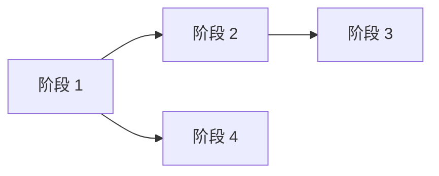

# 开发 RoadMap

> **填写指南**：本文件回答「什么时候做什么、交付什么、依赖什么」。RoadMap 是对需求、设计、团队资源的协调；每个阶段退出条件可验证。本文件的任务级跟踪在 `AGENT-GUIDE.md` 第 8 章。

## 1. 版本规划

> **填写指南**：从 MVP 到后续版本的粗粒度路线。每个版本说明主题、目标用户、关键功能、退出条件。

| 版本 | 主题 | 目标用户 | 关键功能 | 退出条件 |
| --- | --- | --- | --- | --- |
| `v0.1 MVP` | `<主题>` | `<用户>` | `<功能>` | `<条件>` |

## 2. 阶段划分

> **填写指南**：MVP 范围内按主题拆分阶段（通常 1-4 周一个阶段）。每阶段说明目标、交付物、依赖、风险。

### 2.1 阶段 `<N：主题>`

- **周期**：`<YYYY-MM-DD ~ YYYY-MM-DD>`
- **目标**：`<可验证目标>`
- **交付物**：
  - `<交付物 1>`
  - `<交付物 2>`
- **依赖**：`<前置阶段 / 外部依赖>`
- **风险**：`<潜在风险 + 缓解>`
- **退出条件**：
  - [ ] `<条件 1>`
  - [ ] `<条件 2>`

## 3. 任务分解

> **填写指南**：每阶段细化到可登记的任务（`XX-NNNN`），登记在 `AGENT-GUIDE.md` §8。任务粒度建议 0.5-3 天完成；超过的拆分。

| 阶段 | 任务 ID | 任务 | 优先级 | 预估 |
| --- | --- | --- | --- | --- |

## 4. 里程碑

> **填写指南**：对内对外公告的关键节点。每个里程碑有明确的功能集和日期。

| 里程碑 | 日期 | 功能集 | 对内/对外 |
| --- | --- | --- | --- |

## 5. 依赖图

> **填写指南**：阶段间、功能间的强弱依赖。强依赖必须按序，弱依赖可并行。

## 6. 风险跟踪

> **填写指南**：持续识别和跟踪影响 RoadMap 的风险。周期性评审。

| # | 风险 | 影响 | 概率 | 应对 | Owner | 状态 |
| --- | --- | --- | --- | --- | --- | --- |

## 7. 变更记录

| 版本 | 日期 | 变更说明 |
| --- | --- | --- |
| `<0.1.0>` | `<YYYY-MM-DD>` | `<初始化>` |
